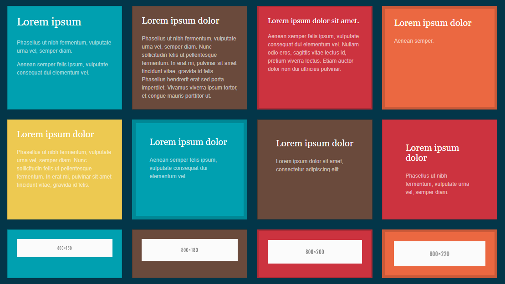

# vanilla-match-height.js #

[](https://opensource.org/licenses/MIT)
[](http://www.typescriptlang.org/)
[](https://socket.dev/npm/package/vanilla-match-height)
[](https://www.jsdelivr.com/package/npm/vanilla-match-height)
[](https://www.npmjs.com/package/vanilla-match-height)
[](https://www.npmjs.com/package/vanilla-match-height)
[](https://yarnpkg.com/package?name=vanilla-match-height)

## *Inspired by:* jquery-match-height

> *matchHeight:* makes the height of all selected elements exactly equal

[Demo](#demo) - [Features](#features) - [Install](#install) - [Usage](#usage-html) - [Class API](#class-api) - [Options](#options) - [Data API](#data-api)  
[Advanced Usage](#advanced-usage) - [Changelog](#changelog) - [License](#license)

### Demo

- [demo HTML](https://codepen.io/Simone-Miterangelis/pen/XWLPqJQ)
- [demo Javascript](https://codepen.io/mitera/pen/mdvaKBN).

[](https://github.com/mitera/vanilla-match-height/archive/refs/heads/master.zip)

### Modern browsers

In the years since this library was originally developed there have been updates to CSS that can now achieve equal heights in many situations. If you only need to support modern browsers then consider using [CSS Flexbox](https://css-tricks.com/snippets/css/a-guide-to-flexbox/) and [CSS Grid](https://css-tricks.com/snippets/css/complete-guide-grid/) instead.

### Best practice

Use this library to match height of internal elements, like title or text of teasers 

### Features

- match the heights for groups of elements automatically
- use the maximum height or define a specific target element
- anywhere on the page and anywhere in the DOM
- responsive (updates on window resize)
- row aware (handles floating elements and wrapping)
- accounts for `box-sizing` and mixed `padding`, `margin`, `border` values
- handles images and other media (updates after loading)
- easily removed when needed
- data attributes API
- tested in Edge, Chrome, Firefox

### Install

CDN via jsDelivr
```html
<script src="https://cdn.jsdelivr.net/npm/vanilla-match-height@2/dist/vanilla-match-height.min.js" type="text/javascript"></script>
```
Pin a version (`@2` for the latest 2.x release, or an exact one such as `@2.1.0`) instead of `@latest`, so that a new major release cannot change your site unexpectedly. For an exact version you can also add the `integrity` attribute provided by [jsDelivr](https://www.jsdelivr.com/package/npm/vanilla-match-height).

Download [vanilla-match-height.js](https://github.com/mitera/vanilla-match-height/blob/master/dist/vanilla-match-height.js) and include the script in your HTML file:
```html
<script src="vanilla-match-height.js" type="text/javascript"></script>
```
You can also install using the package managers [NPM](https://www.npmjs.com/package/vanilla-match-height).
```console
npm install vanilla-match-height
```
modular code
```js
import 'vanilla-match-height'
```
The import adds `matchHeight()` to `HTMLElement` and also exports the `MatchHeight` class.
To use only the class, without extending `HTMLElement`, import `vanilla-match-height/core` (see [Class API](#class-api)).

| Entry point | `HTMLElement.prototype.matchHeight` | Exports |
|---|---|---|
| `<script src=".../dist/vanilla-match-height.min.js">` | added | `window.MatchHeight` |
| `import 'vanilla-match-height'` / `require('vanilla-match-height')` | added | `MatchHeight` (named and default), `installMatchHeight` |
| `import 'vanilla-match-height/core'` / `require('vanilla-match-height/core')` | not added | `MatchHeight` (named and default) |

The package can be imported during server-side rendering: outside the browser nothing is added to `HTMLElement`.

#### TypeScript

Type definitions are included. The import adds `matchHeight()` to `HTMLElement`; the options type is `MatchHeightSettings` and the returned instance is `MatchHeight`:
```ts
import 'vanilla-match-height';

const options: MatchHeightSettings = { elements: '.item', property: 'min-height' };
const mh: MatchHeight = document.body.matchHeight(options);
```
With the class API the same types are exported:
```ts
import { MatchHeight, type MatchHeightSettings } from 'vanilla-match-height/core';

const options: MatchHeightSettings = { elements: '.item', property: 'min-height' };
const mh = new MatchHeight(document.body, options);
```
### Usage html

use `data-mh` attribute for set group name
```html
<div class="row">
    <div class="col-12 col-sm-6">
        <h2 data-mh="title">Lorem ipsum dolor sit amet, consectetur adipiscing elit.</h2>
        <p data-mh="description">Lorem ipsum dolor sit amet, consectetur adipiscing elit.</p>
    </div>
    <div class="col-12 col-sm-6">
        <h2 data-mh="title">Lorem ipsum dolor sit amet.</h2>
        <p data-mh="description">Lorem ipsum dolor sit amet, consectetur adipiscing elit. Nullam a nisi hendrerit, viverra felis non, aliquam sapien. In faucibus justo massa, non pretium urna lacinia id. </p>
    </div>
</div>
<script>
    document.body.matchHeight();
</script>
```
The example above sets the maximum height of the tags for the title and then for the description.

Also see the [Data API](#data-api) below for a simple, alternative inline usage.

### Usage javascript
```html
<div class="items-container">
    <div class="item">
        <h2>Lorem ipsum dolor sit amet, consectetur adipiscing elit.</h2>
        <p>Lorem ipsum dolor sit amet, consectetur adipiscing elit.</p>
    </div>
    <div class="item">
        <h2>Lorem ipsum dolor sit amet.</h2>
        <p>Lorem ipsum dolor sit amet, consectetur adipiscing elit. Nullam a nisi hendrerit, viverra felis non, aliquam sapien. In faucibus justo massa, non pretium urna lacinia id. </p>
    </div>
</div>
<script>
    document.body.matchHeight({elements: '.item'});
    //or
    const containers = document.querySelectorAll(".items-container");
    containers.forEach((container) => {			
        container.matchHeight({elements: '.item'});
    });
</script>
```
The above example will set all selected elements with the class `item` to the height of the tallest.  

If the items are on multiple rows, the items of each row will be set to the tallest of that row (see `byRow` option).

The plugin will automatically update on window load.   

See the included [test.html](https://github.com/mitera/vanilla-match-height/blob/master/test/test.html) for many working examples.

### Class API

`element.matchHeight(options)` is a shortcut for `new MatchHeight(element, options)`: both return the same object, with the same options and [methods](#advanced-usage).
Use the class when you prefer not to extend `HTMLElement` (e.g. in a shared codebase or a library):
```js
import { MatchHeight } from 'vanilla-match-height/core';

const el = new MatchHeight(document.body, {elements: '.item'});
//...
el._apply();
```
With the CDN script the class is available as `window.MatchHeight`:
```html
<script src="https://cdn.jsdelivr.net/npm/vanilla-match-height@2/dist/vanilla-match-height.min.js"></script>
<script>
    const containers = document.querySelectorAll(".items-container");
    containers.forEach((container) => {
        new MatchHeight(container, {elements: '.item'});
    });
</script>
```
The first parameter is the container where the elements are searched; a `TypeError` is thrown if it is not an element.

`window.MatchHeight` is not overwritten if it already exists on the page (e.g. when `module-match-height` is loaded too).

#### Migrating from module-match-height

`module-match-height` is merged into this package. Replace the import, the options and methods are the same:
```js
// before
import MatchHeight from 'module-match-height';
// after
import { MatchHeight } from 'vanilla-match-height/core';
```
Prefer the named import: the default import also works, but TypeScript rejects it in ES modules with `moduleResolution: nodenext`.

### Options

The `options` parameter of `document.body.matchHeight(options)` is optional.

The default values are:
```
{
    elements: null,
    byRow: true,
    property: 'height',
    target: null,
    remove: null,
    attributeName: null,
    attributeValue: null,
    dataApi: true,
    events: true,
    throttle: 80,
    beforeUpdate: null,
    afterUpdate: null
}
```
Where:

- `elements` is an optional string containing one or more selectors to match against. This string must be a valid CSS selector string
- `byRow` is `true` or `false` to enable row detection
- `property` is the CSS property name to set (e.g. `'height'` or `'min-height'`; camelCase such as `'minHeight'` is converted)
- `target` is an optional element to use instead of the element with maximum height
- `remove` is an optional element, `NodeList` or array of elements to exclude: excluded elements keep their natural height and are not used to compute the group height
- `attributeName` is an optional custom attribute name to group elements by its value, in addition to `data-mh` and `data-match-height` (see [Data API](#data-api))
- `attributeValue` is an optional value for `attributeName`: when `elements` is not set, `_apply()` and `_remove()` work on the `[attributeName="attributeValue"]` elements only
- `dataApi` is `true` or `false` to apply the `data-mh` / `data-match-height` groups (see [Data API](#data-api)); set it to `false` on all but one of the instances sharing the same container, so the same groups are not matched more than once
- `events` is `true` or `false` to enable default events (`DOMContentLoaded`, `load`, `resize`, `orientationchange`); with `false` nothing is applied automatically, call `_applyAll()` (or `_apply()`) yourself
- `throttle` is the minimum interval in milliseconds between two updates on `resize`/`orientationchange`, default is `80`; `0` disables throttling
- `beforeUpdate` is a custom method that starts before the height matching process
- `afterUpdate` is a custom method that starts after the height matching process

### Data API

Use the data attribute `data-mh="group-name"` or `data-match-height="group-name"` where `group-name` is an arbitrary string to identify which elements should be considered as a group.
```html
<div data-mh="my-group">My text</div>
<div data-mh="my-group">Some other text</div>
<div data-mh="my-other-group">Even more text</div>
<div data-mh="my-other-group">The last bit of text</div>
<div data-match-height="my-group">My text</div>
<div data-match-height="my-group">Some other text</div>
<div data-match-height="my-other-group">Even more text</div>
<div data-match-height="my-other-group">The last bit of text</div>
```
All elements with the same group name will be set to the same height when the page is loaded, regardless of their position inside the element on which `matchHeight()` is called. One call is required to activate the data API, e.g. for the whole page:
```js
document.body.matchHeight();
```

It's possible to use custom data attribute `data-same-height="group-name"`
```html
<div data-same-height="my-group">My text</div>
<div data-same-height="my-group">Some other text</div>
<div data-same-height="my-other-group">Even more text</div>
<div data-same-height="my-other-group">The last bit of text</div>
```

```js
const containers = document.querySelectorAll(".data-api-items");
containers.forEach((container) => {
    container.matchHeight({attributeName: 'data-same-height'});
});
```
Note that `byRow` will be enabled when using the data API, if you don't want this (or require other options) then use the alternative method above.

Every instance matches the `data-mh` / `data-match-height` groups inside its container. If several instances share a container, set `dataApi: false` on all but one of them:
```js
document.body.matchHeight();                                          // data API groups
document.body.matchHeight({elements: '.item', dataApi: false});       // only .item
document.body.matchHeight({elements: '.card-title', dataApi: false}); // only .card-title
```

### Advanced Usage

There are some additional functions and properties you should know about:

#### Manually trigger an update
All groups are automatically updated when the window is resized.

if you want to manually trigger an update of a specific group, you can use the `_applyAll` method:

```js
let el = document.body.matchHeight();
el._applyAll();
```

If you need to manually trigger an update of all currently set groups, for example if you've modified some content.

```js
window.dispatchEvent(new Event('resize'));
```

#### Row detection

You can toggle row detection by setting the `byRow` option, which defaults to `true`.
Elements are considered in the same row when their top position differs by 1px at most; each row is set to the height of its tallest element. A row with a single element keeps its natural height (unless `target` is set), and hidden elements (`display: none`) are skipped.

#### Custom target element
```js
const containers = document.querySelectorAll(".target-items");
containers.forEach((container) => {			
    container.matchHeight({elements: '.item-0, .item-2, .item-3', target: document.getElementById("target-item-1")});
});
```
Will set the elements `.item-0`, `.item-2` and `.item-3` to the height of the element with id `target-item-1`.

#### Custom property
```js
const containers = document.querySelectorAll(".property-items");
containers.forEach((container) => {			
    container.matchHeight({elements: '.item', property: 'min-height'});
});
```
This will set the `min-height` property instead of the `height` property.

#### Throttling resize updates

By default, the updates on `resize` and `orientationchange` are throttled to execute at a maximum rate of once every `80ms`.
Decreasing the `throttle` option will update your layout quicker, appearing smoother during resize, at the expense of performance.
If you experience lagging or freezing during resize, you should increase the `throttle` option.

#### Manually apply match height

Manual apply, code for JavaScript framework/library (e.g. `vue`, `react` ...).
```js
let el = document.body.matchHeight({elements: '.item'});
//...
el._applyAll(); // elements/attributeValue group + data API groups, with beforeUpdate/afterUpdate callbacks
//or
el._apply(); // only the `elements` (or `attributeName`/`attributeValue`) group
//or
el._applyDataApi('data-mh'); // only the groups of one data attribute
```
#### Remove match height from elements

Reset the inline style property of the `elements` (or `attributeName`/`attributeValue`) group. Groups of the data API are not reset.
Call `_unbind()` first, otherwise the heights are applied again on the next `resize`.
```js
let el = document.body.matchHeight({elements: '.item'});
//...
el._unbind();
el._remove();
```
#### Remove events from match height elements

Remove the `resize`/`orientationchange` listeners, the pending page load updates and any throttled update
```js
let el = document.body.matchHeight({elements: '.item'});
//...
el._unbind();
```
#### Callback events
Since matchHeight automatically handles updating the layout after certain window events, you can supply functions as global callbacks if you need to be notified.
Introduced new settings `beforeUpdate` and `afterUpdate` to allow custom logic to be executed before and after the height matching process. 
```js
beforeUpdate: function () {
    console.log('beforeUpdate action')
},
afterUpdate: function () {
    console.log('afterUpdate action')
}
```
### Known limitations

#### CSS transitions and animations are not supported

You should ensure that there are no transitions or other animations that will delay the height changes of the elements you are matching, including any `transition: all` rules. Otherwise the plugin will produce unexpected results, as animations can't be accounted for.

### Vue3 Example:
```js
import 'vanilla-match-height';
export default {
    name: 'Example',
    mounted() {
        // Created after mount and kept out of data(), so Vue does not make it reactive
        this.matchHeight = this.$el.matchHeight({elements: '.item p'});
    },
    beforeUnmount() {
        this.matchHeight._unbind();
    },
    methods: {
        reMatch() {
            // e.g. after the content has changed
            this.$nextTick(() => this.matchHeight._apply());
        }
    }
}
```
`this.$el` must be an element: use a single root element in the template (or a template ref).

With the class API and TypeScript, without extending `HTMLElement`:
```vue
<script setup lang="ts">
import { onBeforeUnmount, onMounted, ref, watch } from 'vue';
import { MatchHeight } from 'vanilla-match-height/core';

const props = defineProps<{ items: string[] }>();
const container = ref<HTMLElement | null>(null);
// Kept out of ref(), so Vue does not make it reactive
let matchHeight: MatchHeight | undefined;

onMounted(() => {
    matchHeight = new MatchHeight(container.value!, {elements: '.item'});
});
onBeforeUnmount(() => matchHeight?._unbind());
// flush: 'post' runs after the DOM has been updated
watch(() => props.items, () => matchHeight?._apply(), {flush: 'post'});
</script>

<template>
    <div ref="container">
        <div v-for="text in items" :key="text" class="item">{{ text }}</div>
    </div>
</template>
```
`onMounted` runs only in the browser, so this also works with server-side rendering (e.g. Nuxt).

### React Example:
```js
import 'vanilla-match-height';
import { useEffect, useRef } from 'react';

function MyComponent({ items }) {
    const containerRef = useRef(null);

    useEffect(() => {
        // Created after render, so it also works with server-side rendering and StrictMode
        const matchHeight = containerRef.current.matchHeight({elements: '.item p'});
        return () => matchHeight._unbind();
    }, [items]);

    return (
        <div ref={containerRef}>
            {/* ...items */}
        </div>
    );
}
```

With the class API and TypeScript, without extending `HTMLElement`:
```tsx
import { useEffect, useRef } from 'react';
import { MatchHeight } from 'vanilla-match-height/core';

function MyComponent({ items }: { items: string[] }) {
    const containerRef = useRef<HTMLDivElement>(null);

    useEffect(() => {
        const matchHeight = new MatchHeight(containerRef.current!, {elements: '.item'});
        return () => matchHeight._unbind();
    }, [items]);

    return (
        <div ref={containerRef}>
            {items.map((text) => <div className="item" key={text}>{text}</div>)}
        </div>
    );
}
```
With the Next.js App Router, add `'use client'` at the top of the file: effects run only in client components.

### Avoid duplicate instances

Assign the instance to a variable and reuse it, so that multiple event listeners are not created
```js
//Right solution
let el = document.body.matchHeight({elements: '.item'});
//... json update
el._apply();

//Wrong solution
document.body.matchHeight({elements: '.item'});
//... json update
document.body.matchHeight({elements: '.item'})._apply();
```
### Changelog

To see what's new or changed in the latest version, see the [changelog](https://github.com/mitera/vanilla-match-height/blob/master/CHANGELOG.md)

### License

vanilla-match-height.js is licensed under [The MIT License (MIT)](http://opensource.org/licenses/MIT)
<br/>Copyright (c) 2026 Simone Miterangelis

This license is also supplied with the release and source code.
<br/>As stated in the license, absolutely no warranty is provided.